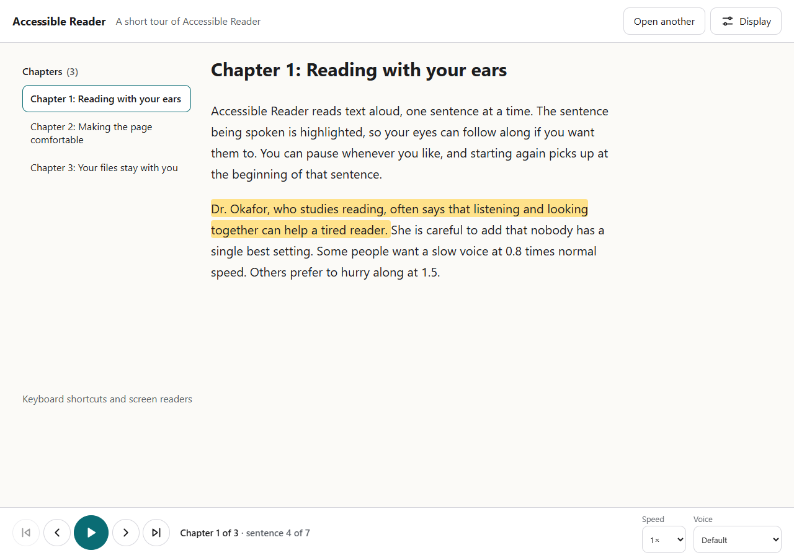
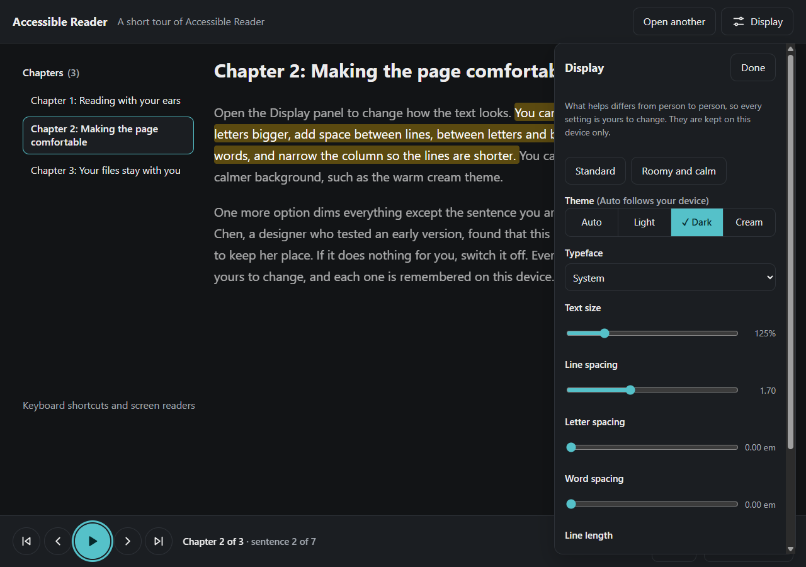
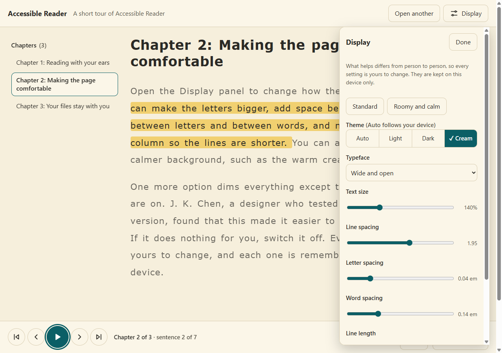
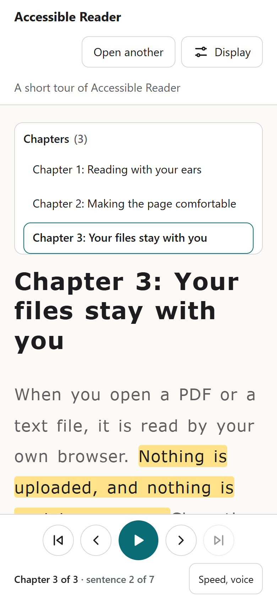

# Accessible Reader

Open a PDF, a text file or some pasted text, and have it read aloud one sentence
at a time, with the sentence being spoken highlighted and a page you can adjust
to suit you. It runs entirely in the browser: the file is never uploaded.

| | |
|---|---|
|  |  |
|  |  |

## What it does

- **Opens** PDF, text and Markdown files, or pasted text. A PDF's own bookmarks
  become chapters when it has them; otherwise chapters are guessed from headings
  ("Chapter 3", "1.2 Methods", all-caps titles), and a long text with none is cut
  into even sections.
- **Reads aloud** with the browser's own speech engine, sentence by sentence.
  Click any sentence to start from it. Pause, skip a sentence or a chapter, change
  the speed and pick a voice. Reading carries on into the next chapter by itself.
- **Remembers your place** in each document, and your display settings, in the
  browser on your device.
- **Adjusts the page**: text size, line spacing, letter and word spacing, line
  length, typeface, and a light, dark or cream theme. A "Roomy and calm" preset is
  a starting point; every value stays yours to change. An optional focus mode dims
  everything except the sentence being read.
- **Works on a phone**: one column, the chapter list folded away, and a compact
  control bar that leaves the text most of the screen.

## Privacy, and how that is checked

The file is read by your browser and never sent anywhere. Two things back that up
rather than just saying it:

- The hosted site sets a Content-Security-Policy with `connect-src 'self'`, so the
  page is not allowed to open a connection to any other site.
- The browser test records every network request during a full session, including
  opening a real PDF, and fails if any goes to another origin or carries a request
  body. In the last run there were 8 requests, all to the site's own origin.

Your place in a document and your display settings are stored in `localStorage` on
your device. There are no accounts, no analytics and no cookies.

## What it cannot do

- **Save an audio file.** A browser will not let a page record its own speech, so
  this reads aloud but cannot export an MP3. Doing that needs a text-to-speech
  engine running locally, which is a different project.
- **Read scanned PDFs.** A PDF that is only pictures of pages has no text; the
  reader says so instead of showing nothing. It does no OCR.
- **Sound the same everywhere.** The voices come from your device, so naturalness
  and language coverage depend on it.
- **Guess every chapter.** Headings are a heuristic. A PDF with no bookmarks and
  unusual headings may come out as even sections.

## How it works

```
file ──► pdf.js text fragments with positions        (PDF only)
     ──► lines ──► paragraphs                         page numbers, headers and
     ──► chapters                                     footers removed, paragraphs
     ──► sentences                                    joined across pages
     ──► speech engine, one sentence at a time
```

- Speech engines cut off long utterances (Chrome stops after about fifteen
  seconds), so the reader speaks one sentence at a time. That also gives the
  highlight small units to follow.
- Pausing stops the current sentence and resuming starts it again from its
  beginning. The browsers' own pause is unreliable, especially on Chrome.
- A cancelled utterance fires its end event late, so every call gets a run number
  and callbacks from an earlier run are ignored.
- The PDF library is loaded only when a PDF is opened, so the main bundle is
  168 KB (56 KB gzipped).

## Design

Built to follow Apple's Human Interface Guidelines, translated for the web:

- **Layout:** a split view with chapters as a sidebar and a distraction-free
  reading pane, collapsing to one column on narrow screens. Controls sit in a
  persistent bar, and the Display panel is non-modal so it never blocks the text.
- **Typography:** `rem` units that respect the browser's text size, text that is
  never justified, adjustable line length, and a typeface option with wide, open
  letterforms.
- **Colour:** semantic theme variables, a light, dark and warm cream theme, and
  dimmed text in focus mode kept above the 4.5:1 contrast ratio. That is computed
  in the browser test for both the dark and cream themes.
- **Input:** every control is at least 44 px, focus is always visible, nothing
  depends on hover, and there are keyboard shortcuts: Space to play or pause, the
  arrow keys for sentences, `[` and `]` for chapters, `-` and `+` for speed. Space
  still presses a focused button rather than toggling playback twice.
- **Motion:** smooth scrolling and transitions are switched off when the system
  asks for reduced motion.
- **Honesty:** a note tells screen-reader users to leave read-aloud paused, since
  two voices at once is confusing.

**Not yet audited with assistive technology.** The structure is checked by
automation, but it has not been tried with VoiceOver, NVDA or JAWS, nor by people
who rely on them. Treat the accessibility claims as "built to the guidance", not
"verified".

## Tests

```bash
npm install
npm test                         # 53 unit tests, Node's built-in runner, no browser
```

The unit tests cover the parts most likely to be subtly wrong: sentence splitting
("Dr. Smith", "3.5 mg", "J. K. Rowling"), chapter detection, rebuilding paragraphs
from PDF positions, the playback controller (including late events from cancelled
speech), and saved position and preferences.

A second test drives the built site in a real Chrome and makes 47 checks: opening
the sample and a real multi-page PDF, chapters found from its headings,
headers, footers and page numbers stripped, a line-end hyphen rejoined, keyboard
control, reading into the next chapter, settings and position surviving a reload,
44 px targets, no sideways scrolling on a phone, contrast of dimmed text, and the
network check above. Headless Chrome has no voices, so the browser test fakes
speech; real voices have not been tried automatically.

```bash
npm run build
npx vite preview --port 4174 &
chrome --headless=new --print-to-pdf=e2e/sample.pdf e2e/sample-pdf.html
node e2e/browser-test.mjs "<path to chrome>" http://localhost:4174/ docs/screenshots e2e/sample.pdf
```

## Bugs the tests found

- **Header removal could delete body text.** A first version treated digits as
  wildcards, so lines that differed only by a number looked like a repeated header.
  It now considers only the top and bottom lines of a page.
- **Footers that differ by a character were missed.** Chrome truncates a long file
  path in a PDF footer to fit, and a wider page number cut it one character sooner
  on page 10. Matching is now fuzzy, but only at the same height on the page and
  within two edits. A looser rule matched templated body lines, which a test
  caught.
- **A duplicated status message** read "Chapter 3: Chapter 3: Your files stay with
  you".
- **The phone player bar covered most of the text.** It is now two compact rows,
  with speed and voice behind a toggle.

## Run it

```bash
npm install
npm run dev        # http://localhost:5174
npm run build
```

Deployed to Vercel with `vercel.json`, which sets the Content-Security-Policy and
the other security headers.

## Roadmap

- [ ] Try it with a screen reader and with people who use these tools
- [ ] Test in Safari and Firefox with real voices
- [ ] A local text-to-speech option so an audio file can be saved
- [ ] OCR for scanned PDFs
- [ ] EPUB and web-page input
- [ ] Word-level highlighting where the speech engine reports word boundaries
