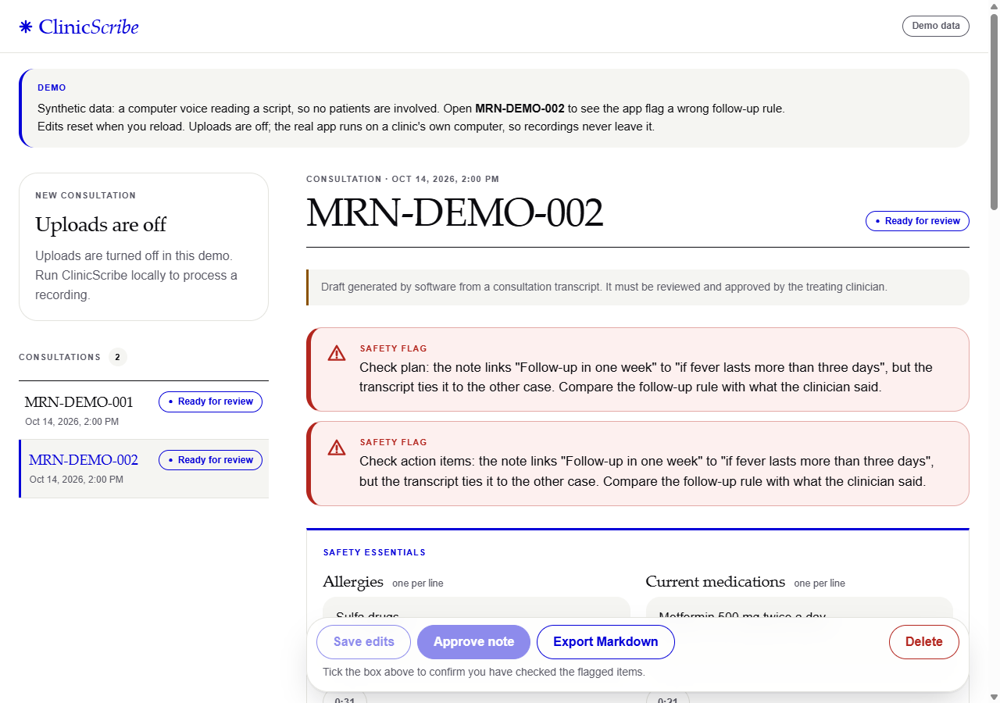

# Voice Agents

A collection of voice-AI projects, each in its own folder with its own README,
setup steps and tests.

| Project | What it is | Stack | Links |
|---|---|---|---|
| [ClinicScribe](ClinicScribe/) | Private consultation notes for clinics. Local speech-to-text and a local LLM draft a SOAP note with every line linked back to the transcript. Speaker labels and deterministic checks catch dropped allergies, wrong doses and reversed follow-up rules. | FastAPI, React, VoiceStudio, Ollama, sherpa-onnx | [Live demo](https://clinicscribe-demo.vercel.app) · [README](ClinicScribe/README.md) |
| [Accessible Reader](AccessibleReader/) | Open a PDF or text file and have it read aloud sentence by sentence, with the current sentence highlighted and a page you can adjust for comfort. Runs entirely in the browser; the file is never uploaded, and a test checks that. | React, pdf.js, Web Speech API | [Live site](https://accessible-reader-three.vercel.app) · [README](AccessibleReader/README.md) |

ClinicScribe's demo runs on synthetic audio only and has uploads turned off. Its
pipeline runs on the user's own machine so recordings never leave it.

More projects will be added here as they are built.
